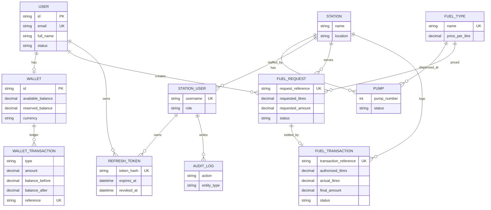

# Prepaid Smart Fuel Dispensing System

A backend (plus a lightweight web portal) for prepaid fuel purchases: customers top up a
wallet, reserve funds for a fuel request, station staff authorize the pump, and the ledger
settles the final payment and releases any unused reserve.

## Tech Stack

- **Runtime:** Node.js 18+, Express 5
- **Database:** PostgreSQL 15 + Prisma ORM
- **Auth:** JWT access tokens + rotating refresh tokens (bcrypt password hashing)
- **Tooling:** ESLint, Prettier, Docker / docker-compose
- **UI:** Vanilla JS single-page portal served by the API (`public/`)

## Project Structure

```
├── api/openapi.yaml          # OpenAPI 3 contract
├── migrations/               # Raw SQL migrations (auto-loaded by docker-compose init)
│   ├── 001_initial.sql
│   └── 002_refresh_tokens.sql
├── prisma/
│   ├── schema.prisma         # Prisma data model (mirrors SQL migrations)
│   └── seed.js               # Demo data: fuel types, station, pumps, users
├── public/                   # Web portal (customer + staff)
└── src/
    ├── index.js              # Express app wiring
    ├── middleware/auth.js    # authenticateToken / authorizeRole
    ├── models/index.js       # Prisma client singleton
    ├── routes/               # auth, customers, wallet, fuel-requests, staff, catalog
    └── services/             # authService, walletService (ledger), fuelService
```

## Getting Started

```bash
cp .env.example .env          # adjust if needed
docker compose up -d db       # start PostgreSQL (runs migrations/*.sql on first init)
npm install
npm run db:push               # sync Prisma schema (idempotent safety net)
npm run seed                  # demo data
npm run dev                   # API + portal on http://localhost:4000
```

Or run everything in Docker: `docker compose up --build`.

### Demo Credentials

| Portal   | Login               | Password       | Role      |
| -------- | ------------------- | -------------- | --------- |
| Customer | `john@example.com`  | `customer123`  | customer  |
| Staff    | `admin`             | `admin123`     | admin     |
| Staff    | `attendant`         | `attendant123` | staff     |

> Change `JWT_SECRET` and all demo passwords before any real deployment.

## API Summary

| Method | Path                                | Auth      | Description                              |
| ------ | ----------------------------------- | --------- | ---------------------------------------- |
| POST   | `/api/customers/register`           | –         | Register customer (creates wallet)       |
| POST   | `/api/auth/login`                   | –         | Login (customer email or staff username) |
| POST   | `/api/auth/refresh`                 | –         | Rotate refresh token, new access token   |
| POST   | `/api/auth/logout`                  | –         | Revoke refresh token                     |
| GET    | `/api/wallet`                       | customer  | Wallet balances                          |
| POST   | `/api/wallet/deposit`               | customer  | Cash deposit (ledger `CASH_DEPOSIT`)     |
| GET    | `/api/wallet/transactions`          | customer  | Paginated ledger history                 |
| GET    | `/api/stations`                     | –         | List stations                            |
| GET    | `/api/stations/:id/pumps`           | –         | Pumps for a station                      |
| GET    | `/api/fuel-types`                   | –         | Fuel types + prices                      |
| POST   | `/api/fuel-requests`                | customer  | Create request + reserve wallet funds    |
| GET    | `/api/fuel-requests`                | customer  | List own requests                        |
| POST   | `/api/fuel-requests/:id/cancel`     | customer  | Cancel + release reserved funds          |
| GET    | `/api/staff/fuel-requests`          | staff     | Alias of `/api/staff/pending-requests`   |
| GET    | `/api/staff/pending-requests`       | staff     | Pending (RESERVED/ACCEPTED) requests     |
| POST   | `/api/staff/requests/:id/accept`    | staff     | Accept: keep reservation, status ACCEPTED |
| POST   | `/api/staff/requests/:id/assign-pump` | staff     | Stage 8: hold a pump for a request       |
| POST   | `/api/staff/requests/:id/reject`    | staff     | Reject: release reservation, status REJECTED |
| POST   | `/api/staff/fuel-requests/:id/authorize` | staff | Authorize pump (FuelTransaction)       |
| POST   | `/api/staff/fuel-requests/:id/cancel`    | staff | Cancel + release                        |
| GET    | `/api/staff/fuel-transactions`      | staff     | Station transaction log                  |
| POST   | `/api/staff/fuel-transactions/:id/complete` | staff | Complete dispense, settle ledger     |
| GET    | `/api/esp32/authorizations/:pump_id` | device¹   | Signed AUTHORIZED transaction for a pump |
| POST   | `/api/esp32/authorizations/:pump_id/ack` | device¹ | Controller reports dispense result      |

<sup>¹</sup> Device endpoints authenticate with the `x-api-key` header (`ESP32_API_KEY`) and are disabled when it is unset.

Full request/response schemas: [`api/openapi.yaml`](api/openapi.yaml).

## Wallet Ledger

Every balance change writes a `wallet_transactions` row with `balance_before`/`balance_after`
(the balance pool the operation touched) and a unique reference:

| Type           | Effect                                              |
| -------------- | --------------------------------------------------- |
| `CASH_DEPOSIT` | `available_balance += amount`                        |
| `RESERVATION`  | `available → reserved` (fails if insufficient funds) |
| `RELEASE`      | `reserved → available` (cancel or unused remainder)  |
| `FUEL_PAYMENT` | `reserved -= amount` (fuel actually dispensed)       |
| `REFUND`       | `available_balance += amount`                        |

Fuel request lifecycle: `RESERVED → ACCEPTED → AUTHORIZED → COMPLETED` (or `CANCELLED`,
`REJECTED`, `EXPIRED`). Reservations expire after 15 minutes — a background job
(`src/jobs/requestExpiryJob.js`, runs every minute) auto-expires stale RESERVED requests and
releases their funds; expiry is also applied lazily when staff list requests or authorize.
All status flips use a status guard so concurrent expiry/accept/reject paths can never
double-release funds.

## Implementation Plan (Spec)

### Stage 0 – Repository & Tooling ✅
- [x] Initialise Git repository
- [x] Add `.gitignore`
- [x] Create `README.md` with spec copy-paste
- [x] Add `package.json`
- [x] Set up ESLint/Prettier
- [x] Create basic `Dockerfile` & `docker-compose.yml`
- **Deliverable:** Repo skeleton on `main`

### Stage 1 – Architecture & Data Model ✅
- [x] Draft ER diagram (below)
- [x] Write migration script `migrations/001_initial.sql`
- [x] Generate ORM models (`prisma/schema.prisma`, `src/models/`)
- [x] Write OpenAPI spec `api/openapi.yaml`
- **Deliverable:** DB schema + API contract

### Stage 2 – Authentication & Authorization ✅
- [x] JWT (access + refresh) implementation
- [x] Role-based middleware (`customer`, `staff`, `admin`)
- [x] Password hashing with bcrypt
- [x] Endpoints: `POST /auth/login`, `/auth/refresh`, `/auth/logout`
- [x] UI login pages for each portal
- **Deliverable:** Secure sign-in for all roles

### Stage 3 – Customer & Wallet Core ✅
- [x] `POST /customers/register` (creates wallet)
- [x] `GET /wallet` (available / reserved balances)
- [x] `GET /wallet/transactions` (paginated)
- [x] Service that records every balance change as a `wallet_transactions` row
      (`CASH_DEPOSIT`, `RESERVATION`, `RELEASE`, `FUEL_PAYMENT`, `REFUND`)
- [x] UI: Dashboard, Wallet page, Transaction history
- **Deliverable:** Fully functional wallet with ledger

### Stage 4 – Station Staff – Cash Deposit Flow ✅
- [x] Search endpoint: `GET /staff/customers?phone=`
- [x] Deposit endpoint: `POST /staff/deposits`
- [x] UI: Customer search + cash-deposit modal + confirmation screen
- **Deliverable:** Staff can credit any customer's wallet; audit log records staff ID

### Stage 5 – Fuel Types & Pricing Service ✅
- [x] `GET /fuel-types` (public)
- [x] Admin CRUD: `POST /admin/fuel-types`, `PATCH /admin/fuel-types/:id`, `DELETE /admin/fuel-types/:id`
- [x] UI: Admin Fuel Types table with live price editing
- **Deliverable:** Centralised fuel catalogue; price snapshot on request creation

### Stage 6 – Customer Fuel Request (Create & Reserve) ✅
- [x] `POST /fuel-requests` validates balance, reserves funds, stores price per litre
- [x] Auto-expire pending requests (background job + lazy expiry, race-safe)
- [x] UI: “Request Fuel” page with station/fuel selectors, live cost estimate, balance check, submit button
- **Deliverable:** Request gets a `request_reference`; funds moved to `reserved_balance`

### Stage 7 – Station Portal – Pending Request Management ✅
- [x] `GET /staff/pending-requests`
- [x] `POST /staff/requests/:id/accept` → keep reservation, status = ACCEPTED
- [x] `POST /staff/requests/:id/reject` → release reservation, status = REJECTED
- [x] UI: Pending Requests table with **Accept** / **Reject** actions
- **Deliverable:** Staff can approve/reject; wallet balances adjust correctly

### Stage 8 – Pump Assignment & Authorization Token ✅
- [x] `POST /staff/requests/:id/assign-pump` (stores `pump_id`, holds pump as RESERVED)
- [x] `POST /staff/requests/:id/authorize` creates `fuel_transactions` row with unique
      `transaction_reference` (`FUEL-YYYYMMDD-NNNNNN`, sequential per day, race-safe) and status `AUTHORIZED`
- [x] Pull endpoint for ESP32: `GET /esp32/authorizations/:pump_id` (HMAC-signed payload,
      API-key auth, optional station pinning)
- [x] UI: Assign Pump dropdown + **Assign** button, **Authorize** enabled once assigned
- **Deliverable:** Signed transaction that the ESP32 can fetch

## ESP32 Pump Controller Integration

Configure in `.env`:

```
ESP32_API_KEY="a-long-random-string"     # x-api-key the controller sends; empty = endpoints disabled
DEVICE_SIGNING_SECRET="another-secret"   # HMAC key; defaults to ESP32_API_KEY
DEVICE_STATION_ID="<station uuid>"       # optional pin for single-station controllers
```

Poll loop on the controller:

1. `GET /api/esp32/authorizations/<pump_id>` with header `x-api-key: $ESP32_API_KEY`
   - `authorization: null` → nothing to dispense, keep polling
   - otherwise verify `signature` = HMAC-SHA256(`DEVICE_SIGNING_SECRET`, fields joined by `|`
     in `signature_payload_fields` order) before dispensing a single millilitre
2. Dispense up to `authorized_litres` at `price_per_litre`
3. Report the result: `POST /api/esp32/authorizations/<pump_id>/ack`
   `{ "transaction_id", "actual_litres", "device_signature" }`
   - server settles the wallet (FUEL_PAYMENT for the dispensed amount, RELEASE for the
     unused reserve) and frees the pump
   - `device_signature` is optional but recommended: it proves the ack came from the
     device that received the signed authorization

## ER Diagram



## License

ISC
